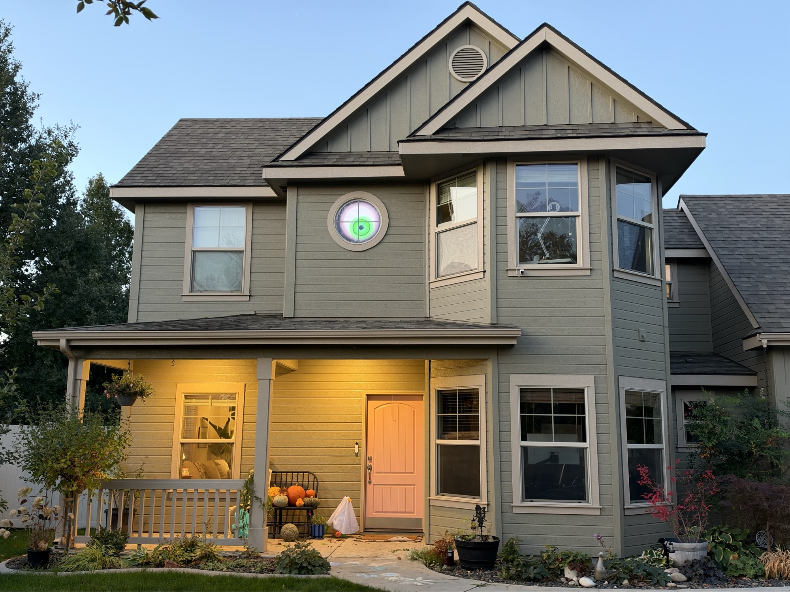
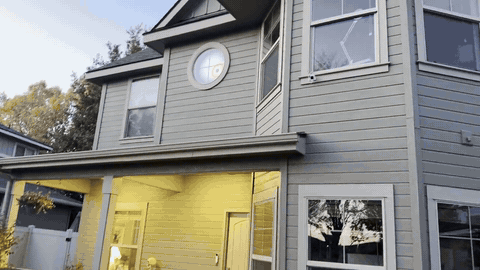
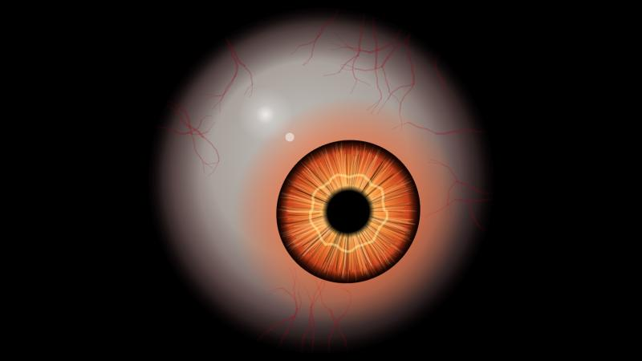
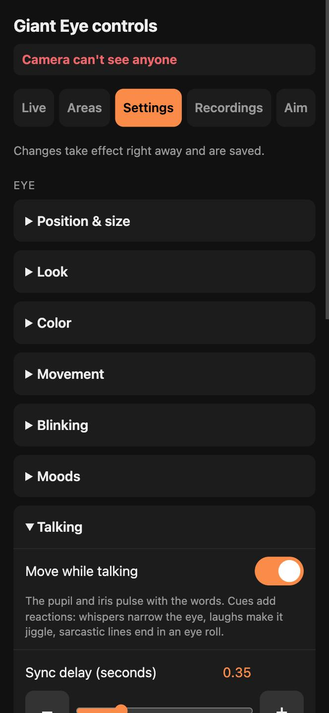
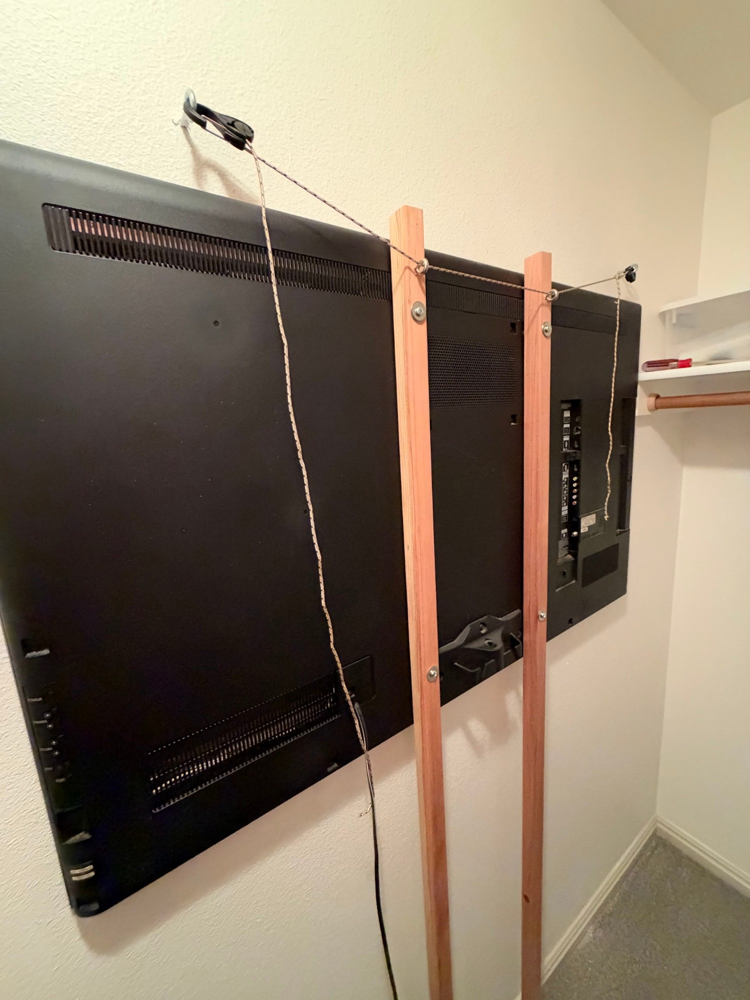

# Giant Eye

A giant eyeball in your window that watches people walk by, and talks to them.

A camera outside spots people, and a TV in the window shows a big glowing eye whose
gaze follows them. It blinks, glances around when nobody's there, rolls its eyes now
and then, and slowly shifts through the colors of the rainbow. Optionally it also
**says a funny line to each passerby** (written by Claude from a photo of them, spoken
by ElevenLabs on a speaker in the yard, with the eye pulsing in time with the words),
and **records a short clip of each visit** with what it said.

<p align="center">
  
</p>
<p align="center">
  
</p>

**[Watch the full video](docs/demo.mp4)**: walking up to the house while the eye follows.

Up close, the eye looks like this:

<p align="center"></p>

## How it works

```
Security camera (RTSP) ──► tracker.py on a Mac
                              • finds people (YOLO), locks onto one person
                              • turns their position into "where the eye looks"
                              • voice.py: photo of the person → Claude writes a line
                                → ElevenLabs speaks it (optional)
                              • recorder.py: a video clip of each visit (optional)
                              • serves the web pages
                                   │
     ┌──────────────────────┬──────┴──────────────┬──────────────────────┐
     ▼                      ▼                     ▼                      ▼
Eye page on the TV    Phone control page    Yard speaker            Camera debug view
(Raspberry Pi kiosk)  /calibrate            (Pi Zero + Bluetooth)   /debug
```

The eye is drawn live in a web browser, so you can try it on any laptop or phone first.

### Privacy: what leaves your network

Without the voice, nothing does: the camera, detection, eye and recordings all stay on
your own network. **With the voice on**, each line sends:
- a small cropped photo of the person (cut from the camera's full-size picture, at most
  640 px) to **Claude** (Anthropic) to write the joke, and
- the line's text to **ElevenLabs** to speak it.

Recordings, and the photo each line was based on (shown on the phone page for checking the
voice's picks, kept 14 days), are saved only on the Mac. The voice never comments on bodies,
faces, age, race or gender, and keeps it kid-friendly.

## What you need

- **A camera with an RTSP stream.** Tested with a Wyze Cam v3 using Wyze's built-in RTSP
  (`rtsps://user:pass@<camera-ip>:322/stream0`). Mount it **outside**: behind window glass
  its night-vision light reflects and it sees the TV.
- **An Apple Silicon Mac to run the tracker.** Detection runs on its GPU at ~14 ms per
  frame, fast enough to check every frame the camera sends.
- **A screen in the window**, driven by a **Raspberry Pi 4** running Chromium in kiosk mode
  (or any device with a browser, like an old iPad, for testing).
- **A phone** for aiming the eye and changing settings while standing outside.
- *For the voice (optional):* an [Anthropic API key](https://console.anthropic.com/) and an
  [ElevenLabs API key](https://elevenlabs.io/). Without ElevenLabs it uses a free voice on
  the Mac (Piper); without Anthropic it says canned lines.
- *For a speaker in the yard (optional):* a **Raspberry Pi Zero 2 W** near a window and a
  **Bluetooth speaker** (tested with an Anker Soundcore 3).

## Setup

### 1. Camera
Get the camera's RTSP address working in VLC first. Then:
```bash
cp camera_url.example.txt camera_url.txt   # put in your camera's address, username and password
chmod 600 camera_url.txt
```
`camera_url.txt` is in `.gitignore`. Never commit it.

### 2. Tracker on a Mac
macOS blocks background programs from `~/Documents`, so run it from your home folder:
```bash
git clone <this repo> ~/giant-eye && cd ~/giant-eye
cp camera_url.example.txt camera_url.txt     # edit it (see above)
brew install ffmpeg
python3 -m venv .venv
.venv/bin/pip install -r requirements.txt
.venv/bin/python tracker.py                  # try it: open http://localhost:8080/
```
To run it all the time as a background service (starts at boot, restarts if it stops,
keeps the Mac awake, serves on port 8085):
```bash
./mac/install.sh                             # asks for your password
```
The service runs as **root** on purpose. macOS "Local Network" privacy blocks other
background programs from reaching the camera; you'd see `No route to host` in the log.
See Apple's TN3179. Log: `~/Library/Logs/giant-eye.log`.

**Updating:** replace the code files; the service notices and restarts itself.

### 3. The display (Raspberry Pi 4)
Raspberry Pi OS (64-bit, desktop) with auto-login. Copy the `pi/` folder to the Pi, then:
```bash
./install.sh http://<tracker-computer-ip>:8085/
```
Restart, and the Pi boots straight into the eye, fullscreen, with no mouse pointer.
It waits for the tracker if it boots first, and restarts the browser if it crashes.
It also keeps itself on Wi-Fi (`pi/net-setup.sh`: power saving off, plus a watchdog that
reconnects after 2 minutes offline and restarts the Pi after 10), so a Wi-Fi drop can't leave
a "password required" box on the screen instead of the eye.
Plug the TV into the micro-HDMI port next to the power port.

The Pi runs the screen at **720p** on purpose: a Pi 4 draws this eye at ~40 frames per
second at 720p but only ~16 at 1080p. The TV scales it up.

### 4. The voice (optional)
Save your API keys next to `tracker.py` (both files are in `.gitignore`). This asks for
each key without showing it:
```bash
read -s "k?Anthropic key: " && printf %s "$k" > anthropic_key.txt && chmod 600 anthropic_key.txt && unset k
```
```bash
read -s "k?ElevenLabs key: " && printf %s "$k" > elevenlabs_key.txt && chmod 600 elevenlabs_key.txt && unset k
```
Then download the free backup voice (used if ElevenLabs fails or has no key):
```bash
.venv/bin/python -m piper.download_voices --download-dir voice/voices en_US-ryan-high
```
Restart the tracker. On the phone page, **Live** shows each line as it's said.

**Cost** (pay-as-you-go API prices): about **$0.005–0.01 per line** in total (Claude Sonnet
~$0.002, ElevenLabs v4 Turbo ~$0.003–0.004). A daily limit (default 150 lines) caps it;
after that it says free canned lines until midnight.

**Characters:** *George (spooky)*, a built-in ElevenLabs voice with a ghostly effect, and
*Witch*, a voice from ElevenLabs' Voice Library (library voices need a paid ElevenLabs
plan or prepaid credits). Add your own in `CHARACTERS` at the top of `voice.py`.

**Recorded lines (faster and cheaper).** A character can have a library of pre-recorded
lines: the Witch's ~95 (`voice/library/witch.json`) cover clothing colors and types, phones,
coffee, dogs, strollers, kids, pairs and groups, waving, jogging, time of day and October.
Record them once (about $0.40 of ElevenLabs credit, a couple of minutes):
```bash
.venv/bin/python voice.py --record-library witch
```
Then under Settings → Voice → *Lines*, choose:
- **Recorded: Claude picks** — Claude looks at the photo and picks the best-fitting line
  (by priority: pets/strollers/kids/bikes, then what they're doing, then clothing). About
  1–1.5 s faster than writing live and ~$0.0014 a line. If nothing fits something remarkable,
  it writes a live line instead.
- **Written live** — Claude writes a fresh line and ElevenLabs speaks it (slowest, most specific).
- **Recorded: random** — instant and free, but not about the person.

**Fast riders:** anyone with a bicycle or motorbike under them (a second copy of the detector
looks for one), moving faster than about 1.3 of their own heights per second (walking a bike
is ~1, riding 1.7–3), gets a quick random line from the library's "fast" set, with no photo
and no AI. Riders come in bunches, so they can talk 4 s after the last line instead of 15.
Anyone else faster than *Skip anyone faster than* is skipped (or gets a fast line too).

**Staying around:** if someone is still near where they were first spoken to (within 2.5 of
their own heights, in a talk zone, still shifting about), the eye writes a fresh line from a
new photo, told what it already said, after 10 s and then every 15 s, up to 6 times per
person. Walkers just passing through don't get one, and nobody gets a line after they've gone.
Someone who stands still for 3 s counts as a person (kids stop to look); settings are under
*When to talk*.

The recordings aren't in git (they're made with your ElevenLabs account and the voice's own
license terms apply); edit a line's text and run the command again with `--redo` to re-record.

### 5. A speaker in the yard (optional)
The lines can also play on the phone page, but for passersby to hear them you want a
speaker outside. A Pi Zero 2 W inside a window streams them to a Bluetooth speaker hidden
in the yard.

1. Flash **Raspberry Pi OS Lite (64-bit)** with Raspberry Pi Imager: hostname `eye-speaker`,
   your Wi-Fi, and SSH turned on.
2. Pair the speaker on the Pi (put the speaker in pairing mode first):
   ```bash
   sudo rfkill unblock bluetooth
   bluetoothctl
   # then in bluetoothctl: agent NoInputNoOutput / default-agent / scan on /
   #   pair <speaker address> / trust <speaker address> / connect <speaker address> / quit
   ```
3. Copy the `speaker/` folder to the Pi as `~/eye-speaker`, then:
   ```bash
   ~/eye-speaker/install.sh http://<tracker-computer>.local:8085 <speaker address>
   ```

It starts at boot, keeps its log across restarts (`journalctl -u eye-speaker`), rejoins Wi-Fi
by itself if it drops off (a watchdog reconnects after 2 minutes offline and restarts the Pi
after 10; `journalctl -u eye-net-watchdog`), reconnects to the speaker whenever it's turned back on, and plays a
nearly silent sound every few minutes so the speaker doesn't switch itself off. Its status
shows on the phone page (*Yard speaker: ready (Soundcore 3, 🔋 72%)*), with a *Test yard
speaker* button. The battery level comes over the speaker's hands-free connection (many
speakers report it there); it turns red at 20%. When it
plays a line it tells the eye, so the eye's pupil pulses in time with the words.

### 6. Aim and tune it from your phone
Open `http://<tracker-computer-ip>:8085/calibrate`:

<p align="center"></p>

- **Live:** the camera view, yard speaker status, the line being said and recent lines (each
  with the photo it was based on, its speed and timing), *Say something now*, *Test yard
  speaker*, today's cost, and buttons to make the eye react.
- **Areas:** draw shapes on the camera picture (tap the corners), all on one view:
  - **Ignored** (gray): things the camera mistakes for a person (a mailbox, a bush).
    Also *Ignore what's in the yellow box*.
  - **Talk** (orange): the line plays once someone's feet are inside. Put one by the speaker.
  - **No-photo** (blue): the voice waits to take its photo while they're inside (far edges,
    where people are too small for a good joke).
  - **Recording** (green): a clip is only saved if they entered one (leave out the road).
  - *Detection sensitivity*: how sure the camera must be that something is a person.
- **Settings:** the eye (position and size, with an alignment guide; look; color; movement;
  blinking; moods; how it moves while talking), the voice (character, Claude model, when to
  talk, cost limit) and recordings. Changes take effect instantly and are saved.
- **Recordings:** watch, save or delete clips; filter to people who *stopped to look*.
- **Aim:** stand in the yard, drag the eye until it looks right at you, and tap
  *Save this spot*. Do 4–6 spots (left, right, near, far). The camera usually isn't where
  the eye is, and this corrects for it.

`/debug` shows what the camera sees: yellow box = person being followed.

### Recordings
On by default. Each visit becomes a clip from a few seconds before the person appears
until they've left, with the eye's line as sound. To cut false alarms, a visit only counts
if they spent a few seconds in a recording area and actually moved (a flickering mailbox
doesn't). If the camera briefly loses someone and picks them up again nearby, it stays one clip. Clips go to `recordings/` next to `tracker.py`; to use another folder, put its
path in `recordings_folder.txt`. Old clips are deleted automatically (default: after 30 days
or over 20 GB). The camera's own video is copied without re-encoding, so recording doesn't
slow anything down and uses the same single camera connection.

- **External drive:** the root background service can't write to `/Volumes/...` unless
  you give its Python *Full Disk Access* (System Settings → Privacy & Security).
- **Sound:** *Record sound* (off by default) adds the camera's microphone. It can pick up
  passersby talking, and recording conversations you're not part of can be restricted by
  law where you live, even in one-party-consent states. Put up a visible "audio and video
  recording" sign before turning it on.

## Tips from building it

- **Mounting the TV.** Ours hangs inside a closet behind the window. Two wood strips
  bolted to the TV's mounting holes and cord to hooks in the wall hold it against the
  window; *Move left / right* on the phone page lines the eye up with the glass.

  

- **Far-away people are the hard part.** At night, small figures far from the camera are
  grainy, and detection struggles. Bigger models and higher resolution *didn't* help on
  real night footage (the extra detail is mostly noise). What helped: lowering *Detection
  sensitivity* to ~0.25, aiming the camera so the sidewalk isn't at the very edge of the
  picture, and more light.
- **It sticks with one person** until they've been gone 1.5 s, and keeps tracking someone
  it's already following even at low confidence, so it doesn't lose them in the dark.
- **Camera delay is small.** Run `camera_delay.py` and open its page on a phone: the screen
  flashes a pattern timed by the Mac's clock, and it measures how late the eye sees it. A Wyze
  v3 over Wi-Fi measured 0.37 s (its burned-in clock is off by ~10 s, so don't judge by that).
- **Wyze cameras sometimes ignore the first connection** while their Wi-Fi wakes up; the
  tracker just retries.
- **Photos come from the full-size picture.** Detection runs on a shrunken 960×540 frame, but
  ffmpeg also writes every frame as a full-size JPEG; the voice crops from the exact frame its
  person-box was measured on (frames are numbered). Cropping from "the newest" one put walkers
  off-centre, since it arrives ~0.3 s later. The crop is padded by the person's height as well
  as their width, so a dog a leash-length ahead of someone seen side-on stays in frame.
- **Speed of the voice.** With recorded lines, a median of about 3.5 s from the eye seeing
  someone to the line being ready (a day of real use: ~1.8 s for a good photo, ~1.6 s for
  Claude picking); written live, about 3.5–4 s after the photo (Claude ~1.5 s, ElevenLabs
  ~1.2 s). Each line's log entry says what held its photo up (a no-photo zone, waiting for
  them to move, the speed check, the full-size picture). *Sonnet 5.5* is much faster than *Opus 5.5*
  (Settings → Voice). The line is prepared as soon as someone appears and held until they
  reach a talk zone, or played right away if they already walked through it. Turning
  Claude's thinking off didn't help; caching the list of recorded lines did (and cut the
  picking cost ~7x).
- **Crackly Bluetooth audio on a Pi Zero.** Its Wi-Fi and Bluetooth share one radio. Medium
  Bluetooth audio quality (SBC "medium", set by `speaker/install.sh`) fixed it; Wi-Fi power
  saving and bigger buffers didn't.
- **Static objects.** Things mistaken for a person don't move, so the voice only talks
  (and recordings only save) once someone's feet have moved.

## Files

| File | What it does |
|---|---|
| `tracker.py` | Reads the camera, detects and follows people, serves the pages |
| `calibration.py` | Turns "where the camera sees you" into "where the eye looks" (from saved spots); ignored areas |
| `settings.py` | The eye settings on the phone page, with allowed ranges |
| `voice.py` | The voice: photo → Claude → ElevenLabs (or Piper), recorded-line libraries, talk/no-photo zones, characters |
| `voice/library/` | Each character's pre-recorded lines (the text; the recordings are made locally) |
| `recorder.py` | A video clip of each visit |
| `camera_delay.py` | Measures how far the camera lags behind real life (phone page) |
| `web/index.html` | The eye (canvas, drawn live) |
| `web/config.js` | Starting values for the eye settings |
| `web/calibrate.html` | Phone page: live view, areas, settings, recordings, aim |
| `mac/` | Background-service setup for a Mac |
| `pi/` | Kiosk setup for a Raspberry Pi (the TV) |
| `speaker/` | Yard speaker for a Raspberry Pi Zero 2 W with a Bluetooth speaker |

Not in git: `camera_url.txt`, `anthropic_key.txt`, `elevenlabs_key.txt`, saved calibration,
areas, settings, line history and photos (`data/`), downloaded voices (`voice/voices/`),
recorded lines (`voice/library/*/`) and clips (`recordings/`).

To try the eye without a camera, open the eye page with `?mouse` at the end of the
address: it follows your mouse or finger, and has buttons for the reactions.

## Credits

Person detection and tracking: [Ultralytics YOLO](https://github.com/ultralytics/ultralytics)
(YOLO11n) with ByteTrack. Lines written by [Claude](https://www.anthropic.com/claude) (Anthropic),
spoken by [ElevenLabs](https://elevenlabs.io/), with [Piper](https://github.com/OHF-Voice/piper1-gpl)
as the free backup voice. Bluetooth audio on the Pi: [BlueALSA](https://github.com/arkq/bluez-alsa).
Built with a lot of help from Claude.

## License

[AGPL-3.0](LICENSE), the same license as the Ultralytics YOLO detector this project
depends on. You're free to use, change and share it; if you share or host a modified
version, share your source too.
